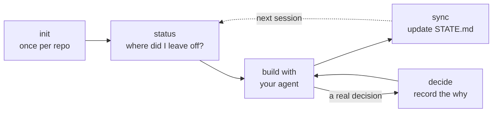
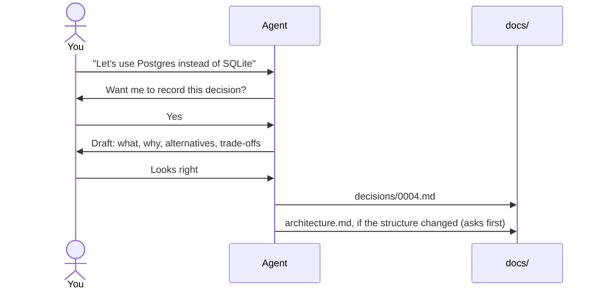
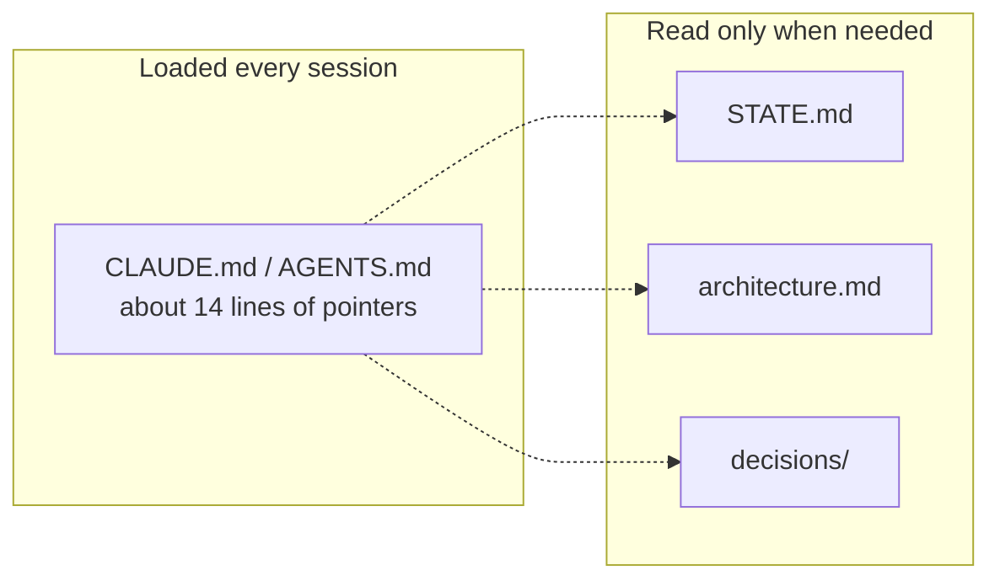

<h1 align="center">orient</h1>

<p align="center">
  <em>Never lose the thread of what you're building.</em>
</p>

<p align="center">
  
  
  
  
  
  
  
</p>

orient keeps a short record of your project inside the repo: where it stands, what you decided, and why. Your coding agent writes it while you work. Nothing is saved until you say yes.

Works with Claude Code, opencode and Codex. Runs on your machine. Makes no network calls. Free and open source.

## The problem

You've been building with an agent for a few months. Then someone asks why you picked this database, or whether that feature ever shipped, and you don't know. The answer was in a chat that scrolled away.

Commit messages say what changed, rarely why. And stuffing everything into `CLAUDE.md` doesn't help: that file loads into every session, so the longer it gets, the more tokens it burns and the less well each rule gets followed.

## How it works



1. **Run `init` once.** It reads your repo in a read-only subagent, drafts the docs, and turns commits that look like turning points into draft decisions. You keep the ones you want.
2. **Build as usual.** When you make a real decision, the agent offers to write it down (see below).
3. **Run `sync` at the end of a session.** `STATE.md` catches up with what you actually did.
4. **Run `status` next time.** It reads one file and tells you where you left off. In Claude Code, the current focus also prints on its own when a session starts.

Here's what happens when you make a call mid-session:



Every write is a draft first. If you say no, nothing changes. The one exception is the rename of old-style decision files after an update (see Updating).

## What it adds to your repo

```
CLAUDE.md or AGENTS.md   about 14 lines of pointers, between ORIENT markers
docs/
  STATE.md               done, in progress, blocked, next up (read this first)
  architecture.md        entry points and module boundaries
  decisions/             one file per decision (0001.md, 0002.md...), never edited, only superseded
```

Each decision's title is its first line. To list them all: `grep -h '^# ADR' docs/decisions/*.md`.



Only the pointers cost you anything up front. Everything else sits on disk until the agent reads it. That's why it holds up on a repo that's years old.

## Install

Pick your agent. Setup takes a couple of commands and one `init` run (about 30 to 60 seconds on a large repo).

<details open>
<summary><b>Claude Code</b></summary>

Inside Claude Code:

```
/plugin marketplace add Chaitanya299/Orient
/plugin install orient@chaitanya299-plugins
```

Or from a terminal:

```bash
claude plugin marketplace add Chaitanya299/Orient
claude plugin install orient@chaitanya299-plugins
```

Then, in a repo you want to track, run `/orient:init`.

</details>

<details>
<summary><b>opencode</b></summary>

```bash
npx @chaitanya299/orient opencode
```

This adds six commands and two agents to `.opencode/`, and writes the pointer block into your `AGENTS.md`. Restart opencode, then run `/orient-init`.

To install for every project, add `--global`. Then run `/orient-init` in each repo you want to track, since the global install can't write a repo's `AGENTS.md` for you.

</details>

<details>
<summary><b>Codex</b></summary>

```bash
npx @chaitanya299/orient codex
```

This adds six skills to `.agents/skills/`, and writes the pointer block into your `AGENTS.md`. Restart Codex, then run `$orient-init`.

To install for every project, add `--global`. Then run `$orient-init` in each repo you want to track, since the global install can't write a repo's `AGENTS.md` for you.

</details>

The opencode and Codex installers only touch the text between the `ORIENT` markers in `AGENTS.md`. Running one again refreshes that block and leaves the rest alone.

## The six commands

| When | Command | What it does |
|---|---|---|
| Once per project | `init` | Sets up the docs and drafts decisions from your git history. |
| Start of a session | `status` | Tells you where things stand. Reads `STATE.md` and nothing else. |
| While building | `trace` | Walks one path through the code with `file:line` refs. Saves nothing. |
| When you decide something | `decide` | Writes the decision and the why. Updates `architecture.md` to match. |
| Before you commit | `commit` | Drafts a what / why / findings commit message for you to review. |
| End of a session | `sync` | Updates `STATE.md` to match what changed. |

Claude Code uses `/orient:status`, opencode `/orient-status`, Codex `$orient-status`. Same six everywhere.

Most days you'll only touch two: `status` to pick up where you left off, and `decide`, which the agent should offer the moment you make a call.

## Check that it's working

- Start a new session and run `status`. You should see the current focus from `STATE.md`.
- Make a choice out loud, like "let's use Postgres for this." The agent should offer to record it. If it doesn't, run `decide` yourself.
- Want to see real output first? orient tracks itself. Read this repo's [`STATE.md`](./docs/STATE.md), [`architecture.md`](./docs/architecture.md) and [decision log](./docs/decisions).

## Before you trust it

- Commit messages and decision files are drafted by the AI from your diff and your chat. They can miss a reason or record the wrong one, so read them before you say yes.
- The agent is prompted to offer `decide`, not forced to. It can miss a decision. When one matters, run `decide` yourself.
- Docs are context, not rules. If something must always hold, put it in a test or a hook.
- Tested on macOS and Linux. Windows (Git Bash, WSL) hasn't been tested yet.

## Security

- No network and no telemetry. It can't send your code anywhere.
- The survey and trace agents are read-only. They never open `.env` files or keys.
- `commit` refuses to commit a `.env` file or a detected key.
- Every write is shown to you first, except the one-time rename of old decision files after an update, which is staged, never committed.

Details in [SECURITY.md](./SECURITY.md).

## Updating

Update, then re-run `init` in each tracked project. The block already in your `CLAUDE.md` / `AGENTS.md` doesn't change on its own. `init` only replaces the text between the markers and never touches `STATE.md` or your decisions.

- **Claude Code:** `claude plugin update orient@chaitanya299-plugins`, restart, then `/orient:init`.
- **opencode / Codex:** `npx @chaitanya299/orient@latest opencode` (or `codex`), then re-run init.

Repos set up before 0.1.8 have decision files named `0001-title.md`. After you update, orient renames them to `0001.md` on its own: at the next session start in Claude Code, or when the installer runs in the repo for opencode and Codex. It fixes links to them, stages the renames and never commits, so check `git status` and commit them like any change. It only does this in repos with orient's `STATE.md` and markers, never while a merge or rebase is in progress, and it leaves a file alone if its number is already taken.

## FAQ

**Will it bloat my `CLAUDE.md` / `AGENTS.md`?**

No. About 14 lines between markers. Re-running `init` replaces them instead of adding more.

**Does it change my code?**

Not without asking. The survey and trace agents are read-only, and every command that writes shows you a draft and waits for your yes.

**What if two people on a team record decision 0018 at the same time?**

Git stops it. Decisions are named by number alone (`0018.md`), so the second branch to merge gets an ordinary merge conflict and can't merge until it's fixed. Keep main's `0018.md`, save yours as the next free number, fix its heading, and commit. No CI or setup needed, as long as everyone on the team is on orient 0.1.8 or later. Older versions name files `0018-title.md`, which git can't catch.

**Can it remind me at commit time?**

Yes, if you opt in. Copy [`pre-commit.sh`](./plugins/orient/scripts/pre-commit.sh) to `.git/hooks/pre-commit` and `chmod +x` it. When a dependency or build file (`package.json`, `go.mod`, `Dockerfile` and so on) is staged with no decision file, it nudges you. Git runs it, so it works with any agent, or none. It only blocks if you set `ORIENT_BLOCK=1`, and `git commit --no-verify` skips it.

## License

Apache License 2.0. See [LICENSE](LICENSE), [CONTRIBUTING.md](CONTRIBUTING.md) and [TRADEMARK.md](TRADEMARK.md).

© 2026 Parasana Sai Chaitanya
