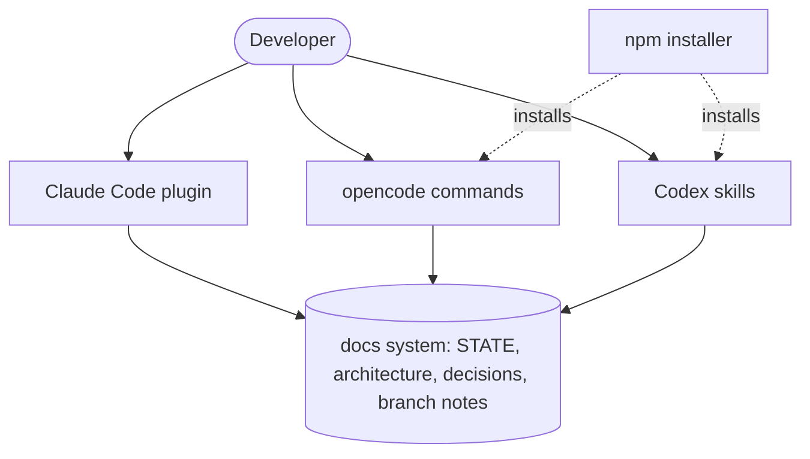

# STATE

## Current focus
Make orient work for teams: 0.1.11 ends STATE.md and architecture.md merge conflicts (ADR-0021).

## Shape

## Done
- Claude Code plugin (six skills, two read-only agents, session-start hook, marketplace) plus
  opencode and Codex ports, all with secret-blind + anti-injection guardrails.
- Security: secret-blind agents, commit secret gate, SECURITY.md, gitleaks CI, which now really
  scans PRs (`GITHUB_TOKEN` + `pull-requests: read`, #3).
- npm/npx distribution (zero-dependency installer), live through 0.1.7. Version-sync gate (ADR-0011).
- `decide` is proactive and keeps architecture.md + the Shape diagram in sync.
- README rewrite with flow diagrams and per-agent install dropdowns (#1, first outside PR).
- 0.1.8 number-only ADR names (ADR-0018): clash blocked for merge, rebase, squash, cherry-pick,
  fork PRs and `git merge-tree`. Live test with real agents: the second PR is blocked and the
  agent renumbers correctly. 0.1.9 auto-rename of old names (ADR-0019), confirmed live.
- 0.1.10 architecture drift warning (ADR-0020), plus this repo's CLAUDE.md block refreshed and
  architecture.md rewritten. Verified through a real marketplace install and an `npm pack` +
  `npx` install for opencode and Codex.
- 0.1.11 team docs (ADR-0021): only the default branch edits STATE.md and architecture.md; other
  branches write `docs/state/<branch>.md`, folded in by `sync` on the default branch. The hook
  prints team goal, this branch's focus and teammates' focus from fetched branches. 96 e2e cases.
  Live-tested with three agents: decide + sync on two branches, merge (one squash), fold on main.
- Decisions recorded: ADR-0001 through ADR-0021.
- Local e2e suite `tests/e2e.test.mjs` (gitignored, ADR-0015), run by `npm test` and the
  `repo-test` agent: 76 cases across solo, team, fork and mixed-agent setups. Replaces the earlier 60-case suite, which
  was lost because it was never committed.

## In progress
- Publish 0.1.11 to npm: `git tag v0.1.11 && git push origin v0.1.11` runs the publish workflow
  (OIDC trusted publishing on npm not yet confirmed; npm is still on 0.1.7). `main` is pushed, so
  Claude Code marketplace users already have 0.1.11.

## Next up
- Team gaps from the friend's review, still open (pinned as `[gap]` tests): opposite decisions
  both land (3, now surfaced side by side at the fold); code built on a superseded ADR merges
  unwarned (5); a revert leaves its separate ADR "accepted" (6a); PM sign-off (7, CODEOWNERS).
- Submit to the official directories (Claude Code: clau.de/plugin-directory-submission;
  Codex: package skills + OpenAI portal; see local PUBLISHING.md).

## Blocked / needs research
- Does decision-capture fire reliably? The triggers now land deterministically (installer writes
  the block, ADR-0016); whether the model *acts* on them is still best-effort and unmeasured.
- Windows (Git Bash, WSL) and Linux untested for `orient.sh` and `migrate-adrs.sh`; the suite
  has only been run on macOS.

## Known issues
- Shape diagram lives in a volatile file (`sync` rewrites STATE.md); drift is possible if a
  structural change skips `decide`.
- Teammates' focus comes from remote branch refs, so a squash-merged branch keeps showing until
  its remote branch is deleted or goes quiet for 14 days. Its note is still folded correctly.
- Shared docs lag until someone opens a session on the default branch and approves the fold.
- `decide` can record the wrong *why*: it infers Context and reason and only asks for alternatives
  and trade-offs. Options: ask for the why in one sentence; mark inferred vs stated fields.
- `decide` doesn't pin the `Superseded by:` format; a live run wrote `0003` without `ADR-`.
- Existing Claude Code repos keep their old CLAUDE.md block until `/orient:init` is re-run, so
  their agents may still write ADRs without `decide`; the drift warning is the backstop.
