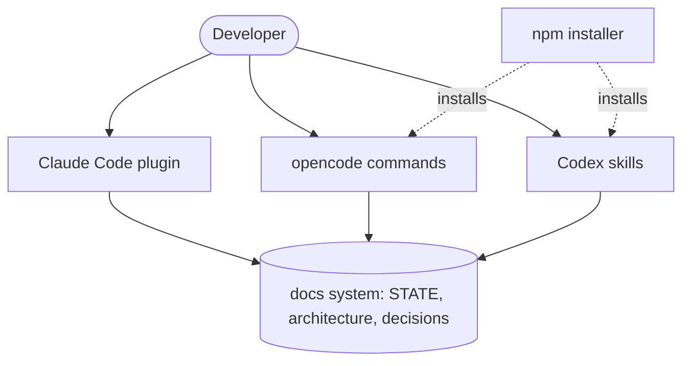

# STATE — <!-- updated: 2026-10-20 -->

## Current focus
0.1.8: ADRs are named by number alone (`decisions/0018.md`, ADR-0018), so two branches that pick
the same number hit a git add/add conflict and the second PR can't merge until renumbered. No CI,
script or hook needed. Raised by a friend testing orient on a team. This repo's 17 ADRs renamed;
`decide`/`init` on all three ports write `NNNN.md` and still count old `NNNN-title.md` files.
0.1.7 is live on npm; the installed Claude Code plugin updates per user, so a team only gets the
clash protection once everyone is on 0.1.8.

## Shape

## Done
- Claude Code plugin: six skills, two read-only agents, session-start hook, marketplace
  manifest. Passes `validate --strict`.
- opencode and Codex ports, each with secret-blind + anti-injection guardrails.
- Security hardening: secret-blind agents, commit secret gate, gitleaks CI, SECURITY.md.
- gitleaks CI now gets `GITHUB_TOKEN` + `pull-requests: read`, so it actually scans PRs
  (it had been exiting early on pull_request events; first seen on PR #1).
- npm/npx distribution (zero-dependency installer); published `@chaitanya299/orient`, live
  through 0.1.2.
- Version-sync gate (ADR-0011): plugin.json is source of truth, package.json mirrors it,
  enforced on publish + CI.
- `decide` is proactive and keeps architecture.md + a STATE Shape diagram in sync.
- Published to github.com/Chaitanya299/Orient; installed from the marketplace, dogfooding.
- Decisions recorded: ADR-0001 through ADR-0018.
- Test suite (ADR-0015): 60 deterministic cases + 10 automated mutants, run locally
  before releases (gitignored, not in CI). Found and fixed on the way in: the installer
  clobbered user-edited command files (later upgraded to a hash-manifest model — untouched
  files auto-update, edited files are preserved as `.new`); the opencode commit port's
  secret patterns had lost their length bounds; `pre-commit.sh` interpolated the docs dir
  into a regex unquoted.

## In progress
- 0.1.7: bumped, suite green, validate passes. Commit + push, then `npm publish` and the
  `v0.1.7` tag are the remaining steps (maintainer runs them, publish needs the OTP).

## Next up
- Publish 0.1.7 to npm, `claude plugin update`.
- Tag `v0.1.7` on GitHub (triggers the provenance publish workflow once trusted publishing is set up).
- Submit to the official directories (Claude Code: clau.de/plugin-directory-submission;
  Codex: package skills + OpenAI portal — see local PUBLISHING.md).

## Blocked / needs research
- Does decision-capture fire reliably? Two layers now: the triggers land deterministically
  (installer writes the block, ADR-0016) after a real opencode run showed the block could go
  missing entirely; whether the model then *acts* on the triggers is still best-effort
  (ADR-0014 cut the `decide`-sweep idea; the opt-in hook is the one deterministic actor). The
  act-on-trigger miss rate is still unmeasured — needs a week of use to confirm. Claude Code
  still writes its own block via `init` (no installer), hardened only by the step-1 backstop.
- Does `scripts/orient.sh` work under Git Bash and WSL on Windows? Untested — the suite
  runs on Linux and macOS only, so this gap is now explicit rather than assumed.

## Known issues
- Shape diagram lives in a volatile file (`sync` rewrites STATE.md); mitigated by the 6-node
  cap and `decide` maintaining it, but drift is possible if a structural change skips `decide`.
